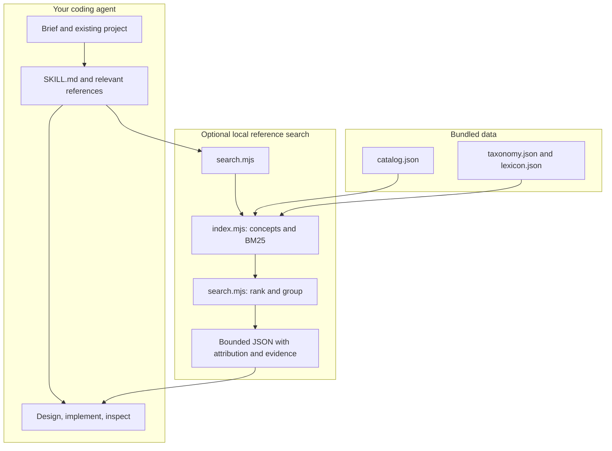

# FORM Design

**A portable skill that helps coding agents design distinctive websites and apps—from art direction to implementation and review.**

[Quick start](#quick-start) · [Download ZIP](https://github.com/aiden-guan/form-design/releases/latest/download/form-design.zip) · [Read the skill](skills/form-design/SKILL.md) · [Research](skills/form-design/references/designer-principles.md) · [Changelog](CHANGELOG.md)

```sh
npx skills add aiden-guan/form-design --skill form-design
```


*The graphic condenses actual CLI output. [Inspect the captured JSON](docs/assets/search-demo.json) or [reproduce it](docs/presentation.md).*

FORM gives an agent a concrete way to choose a visual direction, build a coherent system, and review the result. It combines design guidance with offline discovery across **13,351 attributed public references**. Your existing brand, framework, and requested scope guide the work.

## Quick start

Use the command above with the [Skills CLI](https://github.com/vercel-labs/skills), then choose your agent. It installs into the current project by default; add `-g` for a personal installation. The current installer requires **Node.js 22.20+**. FORM's optional tools require **Node.js 18+**; its written guidance works without a shell.

In Codex, mention `$form-design`. In Claude Code, use `/form-design`:

```text
Use $form-design to build a distinctive site for our ceramics studio.
Use our existing photos and stack. Make it welcoming, with class booking
as the primary task. Choose a direction and implement it.
```

Give the agent real content, an audience, a primary task, and constraints. For a redesign, provide the existing code or an inspectable view. For a faithful match, supply the screenshot or reference.

### Install from the ZIP

[Download](https://github.com/aiden-guan/form-design/releases/latest/download/form-design.zip), extract, and copy the **entire `form-design` folder** to one of these locations:

| Agent | Personal | Project |
| --- | --- | --- |
| Codex | `~/.agents/skills/form-design/` | `.agents/skills/form-design/` |
| Claude Code | `~/.claude/skills/form-design/` | `.claude/skills/form-design/` |
| Other Agent Skills hosts | Use the host's skill import procedure | Preserve the full folder structure |

Keep `SKILL.md`, `references/`, `scripts/`, and `data/` together. Review an existing installation before replacing it. Restart the host if it does not discover the skill. Installation guidance: [OpenAI](https://learn.chatgpt.com/docs/build-skills), [Claude Code](https://code.claude.com/docs/en/skills).

## Four parts of the workflow

| **01 / Choose a point of view** | **02 / Find the right reference** |
| --- | --- |
| Turn audience, content, and purpose into a specific composition, type system, and visual language. Explore different structures when the brief calls for options. | Search by role, material, feeling, or behavior. Read the creator credit, rights label, and evidence limits before inspecting the original. |
| [Art direction](skills/form-design/references/art-direction.md) · [Practitioner research](skills/form-design/references/designer-principles.md) | [Reference search](skills/form-design/references/library.md) · [Live reference handoffs](https://aiden-form-references.aidenguan.chatgpt.site/) |

| **03 / Build for the actual surface** | **04 / Inspect and correct** |
| --- | --- |
| Establish type, spacing, color roles, imagery, and relevant states in a representative slice. A work tool, portfolio, and mobile app need different priorities. | Review rendered output when tooling permits. Correct composition before details; check the actual task, narrow layouts, focus, contrast, and motion alternatives. |
| [Visual craft](skills/form-design/references/visual-craft.md) · [Surfaces](skills/form-design/references/surfaces.md) · [Motion](skills/form-design/references/motion.md) | [Critique protocol](skills/form-design/references/critique.md) · [Five worked examples](skills/form-design/references/examples.md) |

Research is organized into **13 practitioner lenses**, including Frank Chimero, Jen Simmons, Rauno Freiberg, Emil Kowalski, Sara Soueidan, and Maxime Heckel. Each has a primary source, an original summary, an application, and an inspection boundary. The named practitioners do not endorse FORM.

## Try the offline tools

Clone the repository to try the tools independently of an agent. No npm install, API key, account, server, or environment configuration is required for these utilities.

```sh
git clone https://github.com/aiden-guan/form-design.git
cd form-design
node skills/form-design/scripts/search.mjs "retro texture but not glass" --limit 3
```

That query returns these first three candidates in the bundled snapshot:

| Reference | Creator | Recorded reuse class |
| --- | --- | --- |
| Dithered color field | Maxime Heckel | `licensed-source` / MIT |
| Old CRT console look | three.js authors | `licensed-code` / MIT |
| Halftone image treatment | Maxime Heckel | `licensed-source` / MIT |

The full JSON also includes matched concepts, result group, original URL, handoff URL, and evidence limits. These labels record the snapshot's provenance; inspect the original terms before reuse.

| Need | Command after `node skills/form-design/scripts/search.mjs` |
| --- | --- |
| Exact facet intersection | `"intent:hero technique:halftone" --limit 3` |
| A particular collection | `"drawer" --collection 60fps --limit 4` |
| Recorded source availability | `"dither" --reuse licensed-code --limit 3` |
| One known reference | `--id ascii-landscape` |
| Available facets and collections | `--stats` |

For an opaque solid color pair:

```sh
node skills/form-design/scripts/contrast.mjs '#17201b' '#f6f3eb'
```

It returns a contrast ratio of approximately **15.04:1** and text-threshold flags for that pair. Large-text qualification and rendered context still matter; the tool does not audit a page.

## Architecture

The host agent performs design and implementation. FORM supplies instructions and optional deterministic utilities; it does not call a model API itself.



1. The host loads [SKILL.md](skills/form-design/SKILL.md) for a matching task and reads the relevant reference files.
2. Optional discovery enters through [scripts/search.mjs](skills/form-design/scripts/search.mjs), which reads local JSON relative to its installed path.
3. [index.mjs](skills/form-design/scripts/lib/index.mjs) builds concept profiles and field-weighted BM25 data. [search.mjs](skills/form-design/scripts/lib/search.mjs) interprets vocabulary, exclusions, and exact facets, then combines concept coverage, BM25, and a lexical matcher.
4. The CLI returns five candidates by default, at most twelve, with attribution, rights, evidence, and original/handoff links. Opening those links requires internet access.
5. The agent chooses what to inspect, builds within the brief, and reports what it actually verified. Host tools and permissions determine which rendering and interaction checks are possible.

See [architecture and tradeoffs](docs/architecture.md) for implementation details and source pointers.

## Engineering decisions

| Decision | Problem and approach | Why and tradeoff |
| --- | --- | --- |
| **Vocabulary plus lexical retrieval** | Casual requests mix behavior, feeling, and implementation terms. The index combines concept coverage, field-weighted BM25, and the existing lexical matcher. | Search stays local and inspectable. Vocabulary is primarily English, approximate matches need judgment, and the snapshot can age. |
| **Selective context** | A catalog is much larger than a useful design brief. The skill routes to relevant writing and bounded CLI output instead of loading all records into an agent's context. | Keeps discovery focused. The host still decides when to invoke the skill and which evidence to inspect. |
| **Verified release archive** | An archive can be stale or depend on its author's checkout. The packager allowlists files and fixes ordering/metadata; the verifier compares members to source and runs extracted tools in a temporary folder. | Same source and build environment reproduce the archive. The archive checks do not measure the visual quality of an agent's designs. |

## Repository map

```text
skills/form-design/
├── SKILL.md              Entry point and task routing
├── agents/openai.yaml    Codex discovery metadata
├── references/           Design methods, research, and worked examples
├── scripts/              Offline search, retrieval engine, and contrast tool
└── data/                 Public metadata snapshot, vocabulary, and provenance
scripts/                  Archive packaging, verification, presentation generation
tests/                    Node's built-in test suite
evals/                    Behavioral scenarios for future model evaluations
docs/                     Architecture, presentation evidence, and release notes
```

| Responsibility | Implementation |
| --- | --- |
| Skill and design guidance | Markdown with Agent Skills frontmatter |
| Local search and color calculation | Node.js ES modules and built-in APIs |
| Reference data | JSON files; no database or remote search service |
| Packaging and evidence generation | Python standard library; Node for tool execution |
| Distribution | Public GitHub source and versioned release assets |

## Development and verification

With Node.js 18+ and Python 3, from a checkout:

```sh
node --test tests/design-skill.test.mjs
python3 scripts/package-design-skill.py
python3 scripts/verify-design-skill-archive.py
python3 scripts/generate-presentation.py --check
```

The **nine tests** cover catalog integrity, public metadata fields, retrieval, negation, filters, CLI arguments, contrast thresholds, and local reference links. Archive verification extracts the actual generated ZIP and runs both tools from a clean folder. Presentation verification checks the committed SVGs and JSON against current CLI output.

`releases/` is generated locally and ignored by Git. Download published artifacts from [GitHub Releases](https://github.com/aiden-guan/form-design/releases); verify the ZIP with its accompanying `form-design.zip.sha256`. The reference snapshot's input hashes record provenance and are not dependencies on another checkout.

## Status and limits

**v1.0.0 is published.** The source, ZIP download, and fresh Codex project installation were verified during publication. Tests and extraction checks establish tool and packaging behavior; model-generated design quality has not been benchmarked across hosts or models.

- The **2026-11-02** reference snapshot includes imported metadata. Every reference was not individually operated or visually audited, and links or licenses may change.
- Creator media, fonts, code bundles, full essays, and private projects are excluded. Reference-only entries require original implementation or separate permission.
- The host model, supplied assets, context, and available execution tools affect the result. A successful build alone is not visual or accessibility verification.
- Future improvements can be evaluated using the [behavioral scenarios](evals/form-design.md). They are test inputs, not completed evaluation results.

For a useful improvement report, include the prompt, relevant constraints, artifact, and observed problem. Keep changes tied to demonstrated behavior rather than accumulating universal style rules.

## License

FORM's original writing, summaries, examples, and tools are [MIT licensed](LICENSE). Third-party references retain their own terms. Read [NOTICE.md](NOTICE.md) and inspect source licenses before copying work.
