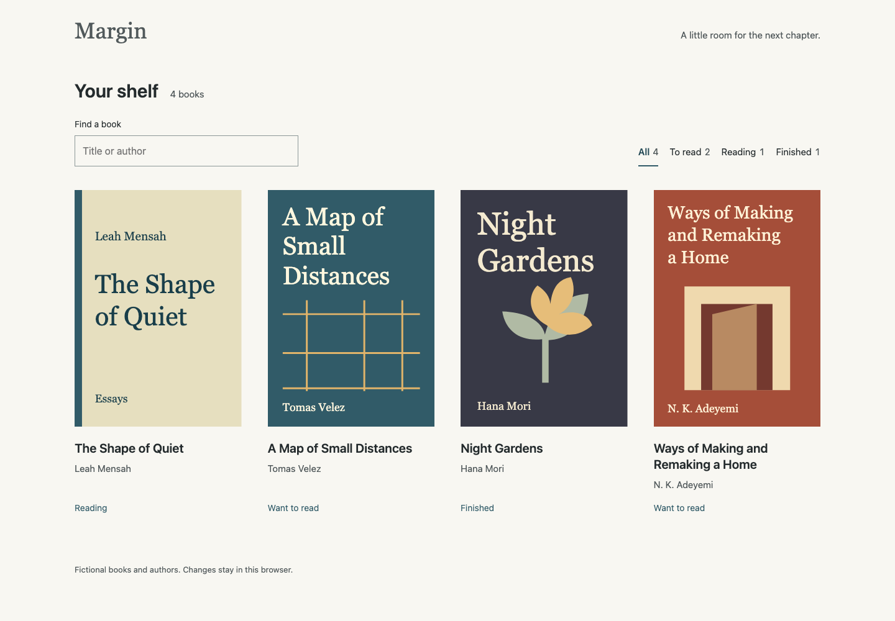
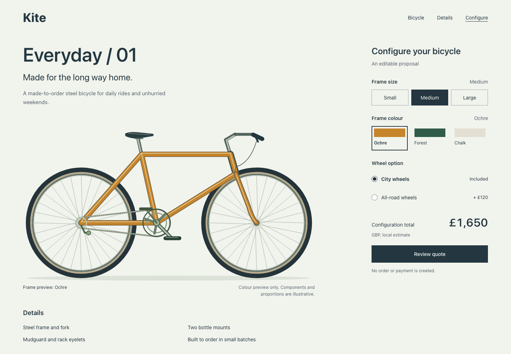
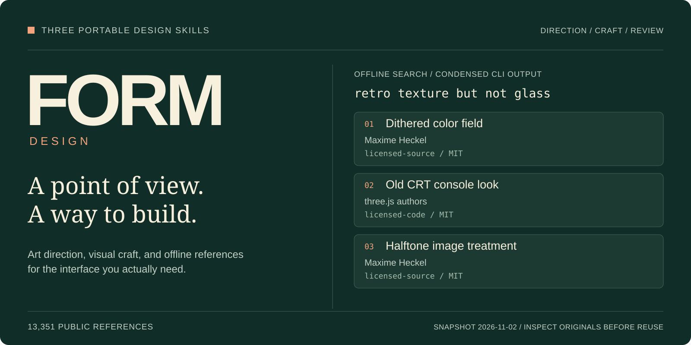
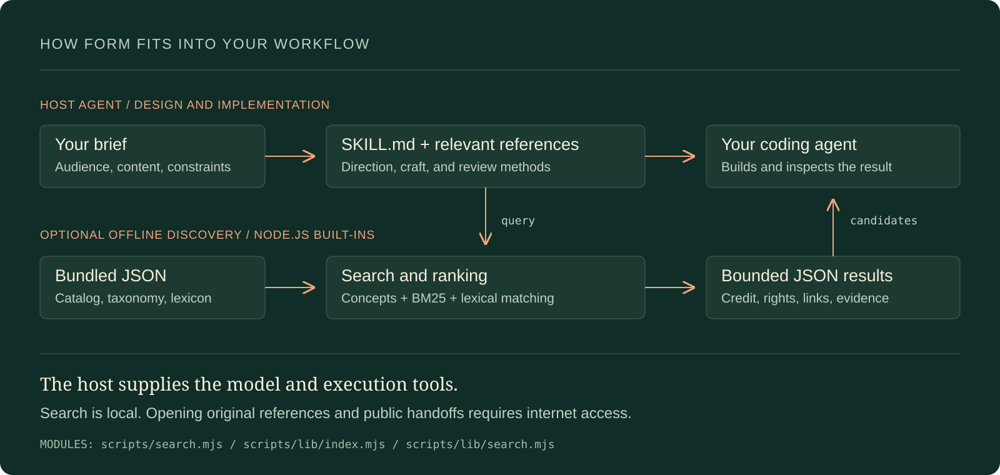
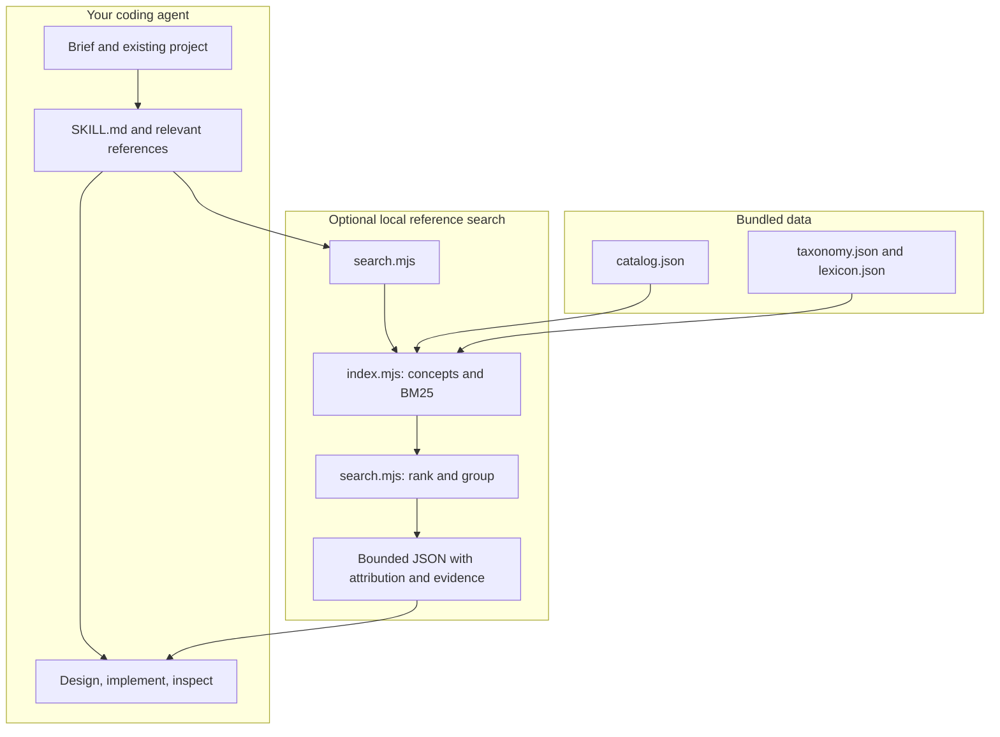

# FORM Design

**Three portable skills for designing distinctive interfaces, repairing generic design, and choosing a visual direction with confidence.**

[Quick start](#quick-start) · [Download suite](https://github.com/aiden-guan/form-design/releases/latest/download/form-design-suite.zip) · [Research](docs/research/2026-11-03-design-quality.md) · [Changelog](CHANGELOG.md)

```sh
npx skills add aiden-guan/form-design
```

| Reading shelf | Bicycle configuration |
| --- | --- |
|  |  |

These are actual runnable examples, with original synthetic content. [Download the offline gallery](https://github.com/aiden-guan/form-design/releases/latest/download/form-design-evidence.zip) or read the [development results and limits](evals/paired-2026-11-03/results.md). Earlier drafts were rejected for violating the unslop criteria and are retained in the record. The corrected examples include reviewed repairs; they are not an unassisted model benchmark.

FORM gives an agent a concrete way to choose a visual direction, build a coherent system, and review the result. It combines design guidance with offline discovery across **13,351 attributed public references**. Your existing brand, framework, and requested scope guide the work.

| Skill | Use it for | Download |
| --- | --- | --- |
| [FORM Design](skills/form-design/SKILL.md) | Create and implement a coherent interface; use references, real content, and actual visual review. | [ZIP](https://github.com/aiden-guan/form-design/releases/latest/download/form-design.zip) |
| [FORM Unslop](skills/form-unslop/SKILL.md) | Diagnose generic choices and repair their cause while preserving useful detail and approved style. | [ZIP](https://github.com/aiden-guan/form-design/releases/latest/download/form-unslop.zip) |
| [FORM Explore](skills/form-explore/SKILL.md) | Compare directions, fonts, and semantic palettes; implement the user's chosen combination. | [ZIP](https://github.com/aiden-guan/form-design/releases/latest/download/form-explore.zip) |

Each skill works independently. Only FORM Design includes the large reference index. The [complete suite ZIP](https://github.com/aiden-guan/form-design/releases/latest/download/form-design-suite.zip) includes all three and an installation guide.

## Quick start

Use the command above with the [Skills CLI](https://github.com/vercel-labs/skills), then choose your agent. It installs into the current project by default; add `-g` for a personal installation. The current installer requires **Node.js 22.20+**. FORM's optional tools require **Node.js 18+**; its written guidance works without a shell.

In Codex, mention `$form-design`, `$form-unslop`, or `$form-explore`. In Claude Code, use the corresponding slash command:

```text
Use $form-design to build a distinctive site for our ceramics studio.
Use our existing photos and stack. Make it welcoming, with class booking
as the primary task. Choose a direction and implement it.
```

Give the agent real content, an audience, a primary task, and constraints. For a redesign, provide the existing code or an inspectable view. For a faithful match, supply the screenshot or reference.

For a targeted install, append `--skill form-unslop` or another skill name. To repair an existing page, try “Use $form-unslop to improve this page's hierarchy and remove redundant framing; keep our chosen typeface and working filters.” To choose type/color, try “Use $form-explore to compare three fonts on this actual content while keeping the layout and palette stable.”

### Install from the ZIP

[Download the suite](https://github.com/aiden-guan/form-design/releases/latest/download/form-design-suite.zip), extract, and copy the desired **complete skill folders from `skills/`** into your host's skill directory. An individual ZIP contains its one named skill folder.

| Agent | Personal | Project |
| --- | --- | --- |
| Codex | `~/.agents/skills/` | `.agents/skills/` |
| Claude Code | `~/.claude/skills/` | `.claude/skills/` |
| Other Agent Skills hosts | Use the host's skill import procedure | Preserve the full folder structure |

Keep `SKILL.md`, `references/`, `scripts/`, and `data/` together. Review an existing installation before replacing it. Restart the host if it does not discover the skill. Installation guidance: [OpenAI](https://learn.chatgpt.com/docs/build-skills), [Claude Code](https://code.claude.com/docs/en/skills).

## The design workflow

| **Choose a point of view** | **Find the right reference** |
| --- | --- |
| Turn audience, content, and purpose into a specific composition, type system, and visual language. Explore different structures when the brief calls for options. | Search by role, material, feeling, or behavior. Read the creator credit, rights label, and evidence limits before inspecting the original. |
| [Art direction](skills/form-design/references/art-direction.md) · [Practitioner research](skills/form-design/references/designer-principles.md) | [Reference search](skills/form-design/references/library.md) · [Live reference handoffs](https://aiden-form-references.aidenguan.chatgpt.site/) |

| **Build for the actual surface** | **Inspect and correct** |
| --- | --- |
| Establish type, spacing, color roles, imagery, and relevant states in a representative slice. A work tool, portfolio, and mobile app need different priorities. | Review rendered output when tooling permits. Correct composition before details; check the actual task, narrow layouts, focus, contrast, and motion alternatives. |
| [Visual craft](skills/form-design/references/visual-craft.md) · [Surfaces](skills/form-design/references/surfaces.md) · [Motion](skills/form-design/references/motion.md) | [Critique protocol](skills/form-design/references/critique.md) · [Five worked examples](skills/form-design/references/examples.md) |

Research is organized into **13 practitioner lenses**, including Frank Chimero, Jen Simmons, Rauno Freiberg, Emil Kowalski, Sara Soueidan, and Maxime Heckel. Each has a primary source, an original summary, an application, and an inspection boundary. The named practitioners do not endorse FORM.

## Unslop with context

The [separate 19-signal checklist](skills/form-unslop/references/signals.md) adapts the supplied Charles Liu notes into **when to investigate → when to keep → what to change**. It covers pills, italic accents, arbitrary type/color choices, excess framing, redundant copy, and other generic-design tells. Dithering is intentionally excluded. The original reel was not independently retrieved; provenance is explicit.

For new work, the checklist is a restraint applied before implementation and again before delivery. Decorative indicator lights, ordinary-action arrows, italic accents, negative tracking, pill labels, repeated eyebrows, and other unsupported defaults stay out. A genre or mood word does not justify adding them. Preserve real status in words, necessary controls, approved references, and useful information density.

An optional [read-only browser inspector](skills/form-unslop/references/browser-inspection.md) collects computed-style observations, selectors, samples, and scan limits, including direct arrow glyphs, small round markers and inline SVG italics. An opt-in text-bound mode helps locate overflowing controls and clipped text. These are review candidates, without a taste score or AI-authorship probability. SVG paths and image contents still need actual visual inspection.

## Choose the fonts and colors yourself

FORM Explore keeps unrelated variables comparable: font choices on the same content and palette; color choices on the same type and geometry; full concepts with the same facts and required states. A user can combine the selected type from one option with another palette, then have the agent verify that combination.

The optional [standalone comparison lab](skills/form-explore/assets/comparison-lab.html) works directly in a browser. It independently switches type systems and semantic palettes, shows text/action/selection/error roles, and exports proposal data. Replace its fictional specimen and example choices with the project's actual content and fonts. The lab is a local decision aid, not a whole-site template or evidence of user approval.

The [research report](docs/research/2026-11-03-design-quality.md) records primary sources, the reviewed public Impeccable/Emil skill snapshots, resulting design decisions, and a protocol for future matched comparisons. Source review and authored examples do not establish superiority over either project.

Two [independent forward tasks](evals/forward-tests-2026-11-03.md) exercise actual skill use: an Unslop critique that preserves useful detail while finding specific workflow concerns, and an Explore task that builds a working two-type × two-palette prototype. Requests, inputs, outputs, screenshots, and verification limits are retained.

The later [corrected-output record](evals/paired-2026-11-03/results.md) applies all 19 signals plus the owner-identified light/arrow defaults to four interfaces. It separates fresh drafts, guided corrections, checklist cross-reviews, task behavior and narrow style checks. Functional success alone did not pass visual acceptance.

## Try the offline tools

Clone the repository to try the tools independently of an agent. No npm install, API key, account, server, or environment configuration is required for these utilities.



*The graphic condenses actual CLI output. [Inspect the JSON](docs/assets/search-demo.json) or [reproduce it](docs/presentation.md).*

```sh
git clone https://github.com/aiden-guan/form-design.git
cd form-design
node skills/form-design/scripts/search.mjs "retro texture but not glass" --limit 3
```

That query returns these first three candidates in the bundled snapshot:

| Reference | Creator | Recorded reuse class |
| --- | --- | --- |
| Dithered color field | Maxime Heckel | `licensed-source` / MIT |
| Old CRT console look | three.js authors | `licensed-code` / MIT |
| Halftone image treatment | Maxime Heckel | `licensed-source` / MIT |

The full JSON also includes matched concepts, result group, original URL, handoff URL, and evidence limits. These labels record the snapshot's provenance; inspect the original terms before reuse.

| Need | Command after `node skills/form-design/scripts/search.mjs` |
| --- | --- |
| Exact facet intersection | `"intent:hero technique:halftone" --limit 3` |
| A particular collection | `"drawer" --collection 60fps --limit 4` |
| Recorded source availability | `"dither" --reuse licensed-code --limit 3` |
| One known reference | `--id ascii-landscape` |
| Available facets and collections | `--stats` |

For an opaque solid color pair:

```sh
node skills/form-design/scripts/contrast.mjs '#17201b' '#f6f3eb'
```

It returns a contrast ratio of approximately **15.04:1** and text-threshold flags for that pair. Large-text qualification and rendered context still matter; the tool does not audit a page.

## Architecture

The host agent performs design and implementation. FORM supplies instructions and optional deterministic utilities; it does not call a model API itself. The diagram shows the core design/reference path. Unslop additionally offers a browser-observation function, and Explore includes a standalone comparison lab; neither requires the reference index.



<details>
<summary>Mermaid source and native diagram</summary>



</details>

1. The host loads [SKILL.md](skills/form-design/SKILL.md) for a matching task and reads the relevant reference files.
2. Optional discovery enters through [scripts/search.mjs](skills/form-design/scripts/search.mjs), which reads local JSON relative to its installed path.
3. [index.mjs](skills/form-design/scripts/lib/index.mjs) builds concept profiles and field-weighted BM25 data. [search.mjs](skills/form-design/scripts/lib/search.mjs) interprets vocabulary, exclusions, and exact facets, then combines concept coverage, BM25, and a lexical matcher.
4. The CLI returns five candidates by default, at most twelve, with attribution, rights, evidence, and original/handoff links. Opening those links requires internet access.
5. The agent chooses what to inspect, builds within the brief, and reports what it actually verified. Host tools and permissions determine which rendering and interaction checks are possible.

See [architecture and tradeoffs](docs/architecture.md) for implementation details and source pointers.

## Engineering decisions

| Decision | Problem and approach | Why and tradeoff |
| --- | --- | --- |
| **Vocabulary plus lexical retrieval** | Casual requests mix behavior, feeling, and implementation terms. The index combines concept coverage, field-weighted BM25, and the existing lexical matcher. | Search stays local and inspectable. Vocabulary is primarily English, approximate matches need judgment, and the snapshot can age. |
| **Selective context** | A catalog is much larger than a useful design brief. The skill routes to relevant writing and bounded CLI output instead of loading all records into an agent's context. | Keeps discovery focused. The host still decides when to invoke the skill and which evidence to inspect. |
| **Verified release archive** | An archive can be stale or depend on its author's checkout. The packager allowlists files and fixes ordering/metadata; the verifier compares members to source and runs extracted tools in a temporary folder. | Same source and build environment reproduce the archive. The archive checks do not measure the visual quality of an agent's designs. |

## Repository map

```text
skills/form-design/
├── SKILL.md              Entry point and task routing
├── agents/openai.yaml    Codex discovery metadata
├── references/           Design methods, research, and worked examples
├── scripts/              Offline search, retrieval engine, and contrast tool
└── data/                 Public metadata snapshot, vocabulary, and provenance
skills/form-unslop/       Contextual diagnostics, 19-signal list, browser inspector
skills/form-explore/      Controlled comparisons and a standalone decision lab
scripts/                  Suite packaging, verification, evidence generation
tests/                    Dependency-free core tests and optional browser tests
evals/                    Scenarios, synthetic fixtures, and rehearsal boundaries
docs/                     Primary research, architecture, evidence, release notes
```

| Responsibility | Implementation |
| --- | --- |
| Skill and design guidance | Markdown with Agent Skills frontmatter |
| Local search and color calculation | Node.js ES modules and built-in APIs |
| Reference data | JSON files; no database or remote search service |
| Packaging and evidence generation | Python standard library; Node for tool execution |
| Distribution | Public GitHub source and versioned release assets |

## Development and verification

With Node.js 18+ and Python 3, from a checkout:

```sh
node --test tests/design-skill.test.mjs
python3 scripts/package-design-skill.py
python3 scripts/verify-design-skill-archive.py
python3 scripts/generate-presentation.py --check
```

The **nine dependency-free tests** cover catalog integrity, public metadata fields, retrieval, negation, filters, CLI arguments, contrast thresholds, and links across all skills. Archive verification checks source equality and safe extraction for all four ZIPs, then runs applicable tools from clean folders. Presentation verification checks the committed SVGs and JSON against current CLI output.

With an existing Playwright installation, nine additional real-browser checks cover read-only inspection, coverage bounds, hidden content, functional filters, reserve/undo, type/palette comparison, text-bound observations, arrow/marker patterns and inline SVG italics:

```sh
node --test tests/inspector.browser.test.mjs
node scripts/capture-rehearsal.mjs
```

Set `FORM_PLAYWRIGHT_MODULE` if that optional maintainer dependency is outside the checkout. The distributed skills do not bundle or require Playwright. Captured examples are labeled synthetic, author-run rehearsals; the tests do not judge beauty.

The corrected examples have separate [task checks](evals/paired-2026-11-03/check-tasks.mjs), [narrow style checks](evals/paired-2026-11-03/check-visual.mjs), actual captures, and full checklist reviews. The [results](evals/paired-2026-11-03/results.md) record their scope and remaining limits. The optional evidence ZIP opens through `gallery.html`; the skill suite remains a separate download.

`releases/` is generated locally and ignored by Git. Download published artifacts from [GitHub Releases](https://github.com/aiden-guan/form-design/releases); verify the ZIP with its accompanying `form-design.zip.sha256`. The reference snapshot's input hashes record provenance and are not dependencies on another checkout.

## Status and limits

**v1.2.0 tightens defaults and adds corrected-output evidence.** The owner rejected the initial examples despite their working interactions. This release applies explicit visual acceptance criteria, retains rejected drafts, and records reviewed corrections. It establishes the reported artifact behavior and specific style checks; general superiority across hosts or over Impeccable/Emil remains untested.

- The **2026-11-02** reference snapshot includes imported metadata. Every reference was not individually operated or visually audited, and links or licenses may change.
- Creator media, fonts, code bundles, full essays, and private projects are excluded. Reference-only entries require original implementation or separate permission.
- The host model, supplied assets, context, and available execution tools affect the result. A successful build alone is not visual or accessibility verification.
- Future improvements can be evaluated using the [scenario suite](evals/scenarios.json) and [comparison protocol](docs/research/2026-11-03-design-quality.md#how-to-establish-an-improvement-claim). They are inputs for evaluation, not completed rival comparisons.

For a useful improvement report, include the prompt, relevant constraints, artifact, and observed problem. Keep changes tied to demonstrated behavior rather than accumulating universal style rules.

## License

FORM's original writing, summaries, examples, and tools are [MIT licensed](LICENSE). Third-party references retain their own terms. Read [NOTICE.md](NOTICE.md) and inspect source licenses before copying work.
