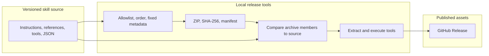

# Architecture and engineering notes

FORM has two distinct responsibilities: written design guidance for a host agent and deterministic offline tools. The agent supplies its own model, filesystem, browser, renderer, and permissions. This repository has no model client, hosted application, database, or provider credentials.

## Instruction path

[SKILL.md](../skills/form-design/SKILL.md) supplies task-selection criteria and the common workflow. The files in [references/](../skills/form-design/references/) separate art direction, craft, surfaces, motion, critique, research, examples, and library use. The host reads only the relevant files; no custom context manager enforces this routing.

This lets a small component edit skip a large discovery process while a substantial creative task can use a direction brief and visual review. It also means the result depends on host instruction-following and available execution tools. The written workflow is guidance, not an autonomous design service.

## Retrieval path

| Stage | Owning module | Behavior |
| --- | --- | --- |
| Parse arguments | [scripts/search.mjs](../skills/form-design/scripts/search.mjs) | Bounds limits to 1–12, rejects conflicting modes and invalid arguments, supports exact ID lookup and collection/reuse filters. |
| Load data | Same CLI | Resolves `data/` relative to `import.meta.url`, so callers need not run from the skill directory. |
| Build profiles | [lib/index.mjs](../skills/form-design/scripts/lib/index.mjs) | Normalizes tokens, builds field-weighted BM25 postings, and maps taxonomy and lexicon concepts. |
| Interpret and rank | [lib/search.mjs](../skills/form-design/scripts/lib/search.mjs) | Recognizes phrases, negation, and facets; combines concept coverage, normalized BM25, and the lexical matcher. |
| Lexical signal | [lib/legacy-search.mjs](../skills/form-design/scripts/lib/legacy-search.mjs) | Adds an independent name/alias/description matching signal. |
| Present | [scripts/search.mjs](../skills/form-design/scripts/search.mjs) | Returns bounded JSON with matched concepts, grouping, provenance, and evidence limits. |

The general-query score starts with concept coverage weighted at 0.72, normalized BM25 at 0.18, and the lexical signal at 0.10, with additional phrase and exclusion adjustments. Relevance cutoffs and concept coverage decide inclusion; exact facets restrict the candidate pool. Scores are retrieval signals, not quality ratings or probabilities.

The engine builds its index in memory for each invocation. That keeps the package dependency-free and avoids an install-time index build, at the cost of repeated parsing and indexing. No latency or memory benchmark is claimed. Its vocabulary is primarily English and can miss unfamiliar phrases; unknown terms are visible in the result.

## Evidence and provenance

The catalog stores metadata, attribution, original URLs, public handoff links, recorded reuse classes, and fidelity/inspection limits. It contains no source bundles or creator media. [manifest.json](../skills/form-design/data/manifest.json) records the snapshot, collection counts, catalog checksum, and upstream input hashes. Those historical input paths do not need to exist in a consumer's checkout.

Rights labels describe the recorded snapshot, not a current license audit. A linked still cannot establish motion; a recording cannot establish source availability. The skill asks the host to inspect originals before reuse and treat external pages as reference data.

## Color calculation

[contrast.mjs](../skills/form-design/scripts/contrast.mjs) accepts opaque three- or six-digit hex sRGB colors, computes relative luminance, and compares the full-precision contrast ratio to text thresholds. It rejects alpha hex values instead of silently assuming a background. The command resolves its real entry path so invocation through a symlinked folder still works.

The tool assesses the supplied pair. It does not infer opacity, background images, large-text qualification, semantic meaning, or full-page accessibility.

## Distribution path

[package-design-skill.py](../scripts/package-design-skill.py) accepts only the skill's declared top-level files and expected resource directories/extensions, rejects symlinked files and local paths, and fixes archive ordering, timestamps, and modes. It writes the ZIP, SHA-256 file, and a release manifest under ignored `releases/`.

[verify-design-skill-archive.py](../scripts/verify-design-skill-archive.py) checks the archive digest and size, rejects unsafe member paths/symlinks, compares every member with current source bytes, then extracts into a temporary folder containing spaces. It runs search, exact lookup, statistics, and contrast commands without installing npm dependencies.

Fixed ZIP metadata makes repeated builds in the same environment reproducible. Compression-library changes can affect archive bytes across environments; the published checksum identifies the actual release artifact. Neither archive integrity nor a successful smoke check establishes model-level design quality.

## Presentation assets

[generate-presentation.py](../scripts/generate-presentation.py) runs the real CLI and creates a compact SVG demonstration plus its unedited JSON evidence. These files are outside the installed skill and do not change the release ZIP. [Presentation notes](presentation.md) describe reproduction and the optional social-preview capture.
