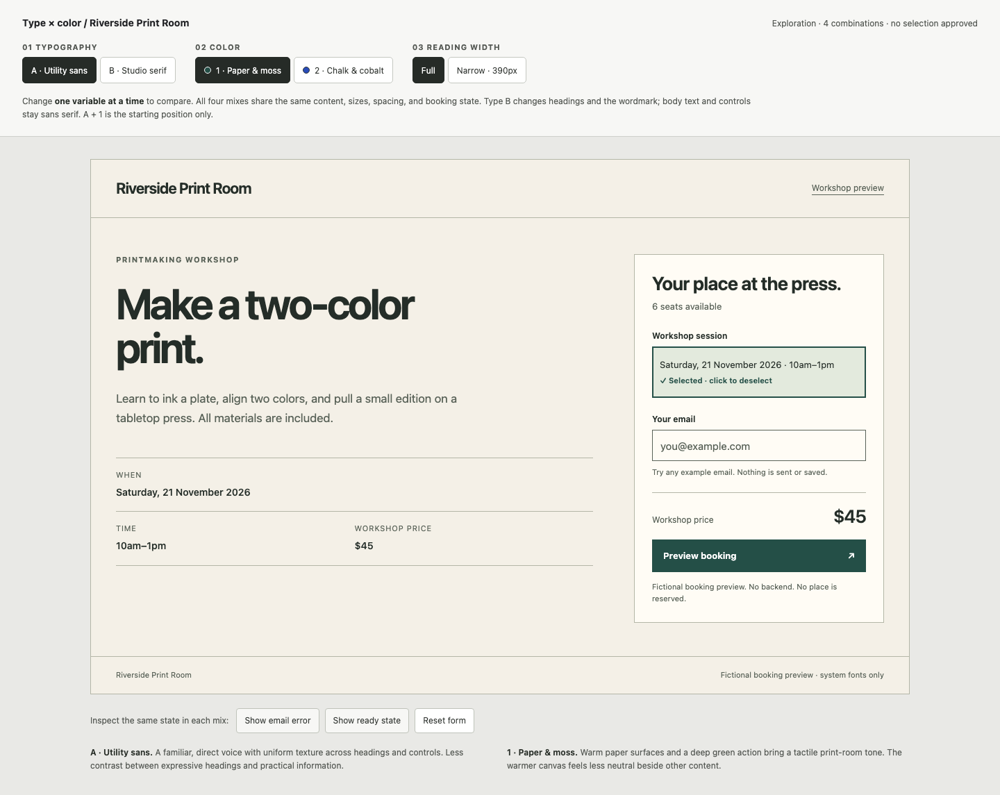
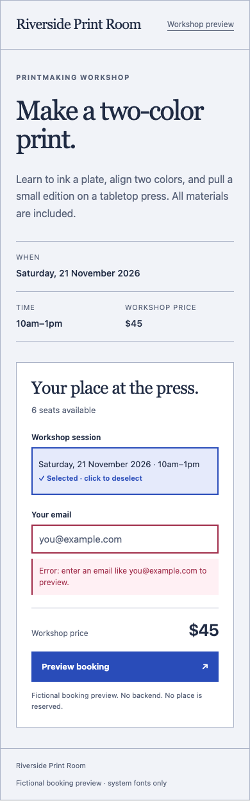

# Independent forward tests — 2026-11-03

Two fresh-context evaluating agents used one skill each to complete a realistic request in an isolated temporary folder. They received the skill, the request below, and minimum raw inputs. They did not receive the expected answer, repository research, other skills, or authored rehearsal conclusions. Network access, publishing, production edits, and further delegation were excluded.

These are qualitative development checks of two tasks. They are not blinded reviews, repeated model trials, or comparisons against Impeccable or Emil's skills. The evaluator model was inherited from the host session rather than independently pinned. The maintainer reviewed the outputs after completion; independence here means separation from the author's expected answer and prior task context, not an independent research organization.

## Unslop: critique an approved working tool

**Input:** A local release queue with working status filters, counts, package identifiers, table boundaries, and compact headers. The raw [input HTML](forward/unslop/index.html) was derived from the preservation fixture with its explanatory context and hidden inspector-test elements removed. No label told the evaluator which visual treatments to preserve.

**Request:**

> Audit this compact release queue for visual design quality and anything that makes it feel generic. It is a frequently used professional tool, and its existing brand/component system is approved. Critique only; don't edit the interface. Keep the working workflow in mind and make only recommendations you can justify.

**Observed outcome:** The [critique](forward/unslop/critique.md) retained useful status/filter pills, mono identifiers, short table headers, and boundaries. It identified concrete concerns: status is offscreen at narrow widths, column positions shift while filtering, and introductory copy promises a selection/review action not demonstrated by the supplied artifact. The evaluator qualified narrow-layout recommendations by the product's actual requirements and did not edit the input.

It reported operation of all three filters, keyboard interaction and scrolling, text-spacing overrides, and solid-pair contrast checks. Its [observations](forward/unslop/audit-observations.json), [additional measurements](forward/unslop/audit-checks.json), and [narrow capture](forward/unslop/audit-narrow.png) are retained. The maintainer confirmed that the input remained unchanged and reviewed the critique against the supplied interface. No screen-reader or real release-handoff claim follows.

## Explore: two type options and two palettes

**Input:** A [brief](forward/explore/brief.json) containing the fictional workshop's name, headline, description, date, time, price, and availability. The skill's optional comparison asset was available; the authored workshop/rehearsal and other skills were not.

**Request:**

> Show me two typography options and two color options for this workshop booking content so I can mix and match them. Use system font stacks, keep the content and layout comparable, and don't pick a winner or integrate it into a real app yet. I want something I can open and try.

**Observed outcome:** The evaluator produced a self-contained [interactive prototype](forward/explore/index.html), with Utility sans / Studio serif and Paper & moss / Chalk & cobalt. Type and palette switch independently across four combinations. Actual workshop facts remain; selected, error, and local preview states can be inspected. The initial state is explicitly unapproved, and nothing was integrated into a production app.

The [handoff](forward/explore/README.md) explains the choices, semantic tokens, scope, and evidence. Its [browser verification script](forward/explore/verify.mjs) passed 64 assertions when rerun by the maintainer: four combinations, 16 additional responsive combinations, local form behavior, keyboard operation, URL persistence, and no non-file requests in an offline Chromium context. Its [results](forward/explore/validation.json) and nine actual screenshots are retained. The lowest calculated text-role contrast in that check was 5.51:1; this is not a full accessibility audit.

The maintainer also checked that palette changes preserve actual specimen geometry/content/type, type changes retain the selected palette, all supplied facts remain, and exactly two options per axis are present. Those [intent checks](forward/explore/maintainer-checks.json) passed. Full and narrow output captures were visually reviewed.

| Initial comparison | A mixed selection at 390px |
| --- | --- |
|  |  |

## Reproduction and interpretation

The input and output artifacts are original synthetic material. Text artifacts retain their substantive content; private temporary paths were normalized, and the Explore verifier's local Playwright import was changed to the optional `FORM_PLAYWRIGHT_MODULE` setting used elsewhere in this repository. Screenshots are actual rendered outputs. No skill instructions changed as a result of these two tasks because the reviewed outcomes did not demonstrate a defect requiring a correction.

To repeat the recorded Explore tooling checks with an existing Playwright installation:

```sh
FORM_PLAYWRIGHT_MODULE=/absolute/path/to/playwright/index.mjs node evals/forward/explore/verify.mjs
```

The browser checks verify the saved artifact. Re-running an agent is a separate experiment and may yield different outputs. The [12-scenario set](scenarios.json) remains prospective, and the [matched comparison protocol](../docs/research/2026-11-03-design-quality.md#how-to-establish-an-improvement-claim) describes the additional evidence needed for broader quality claims.
