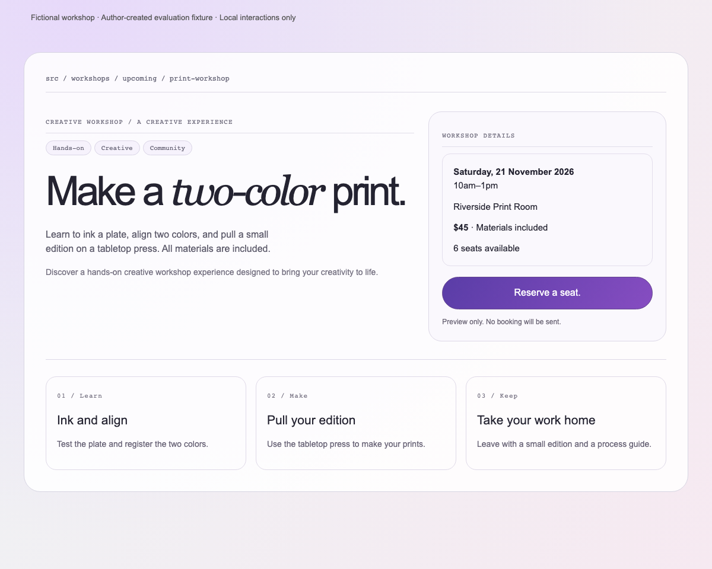
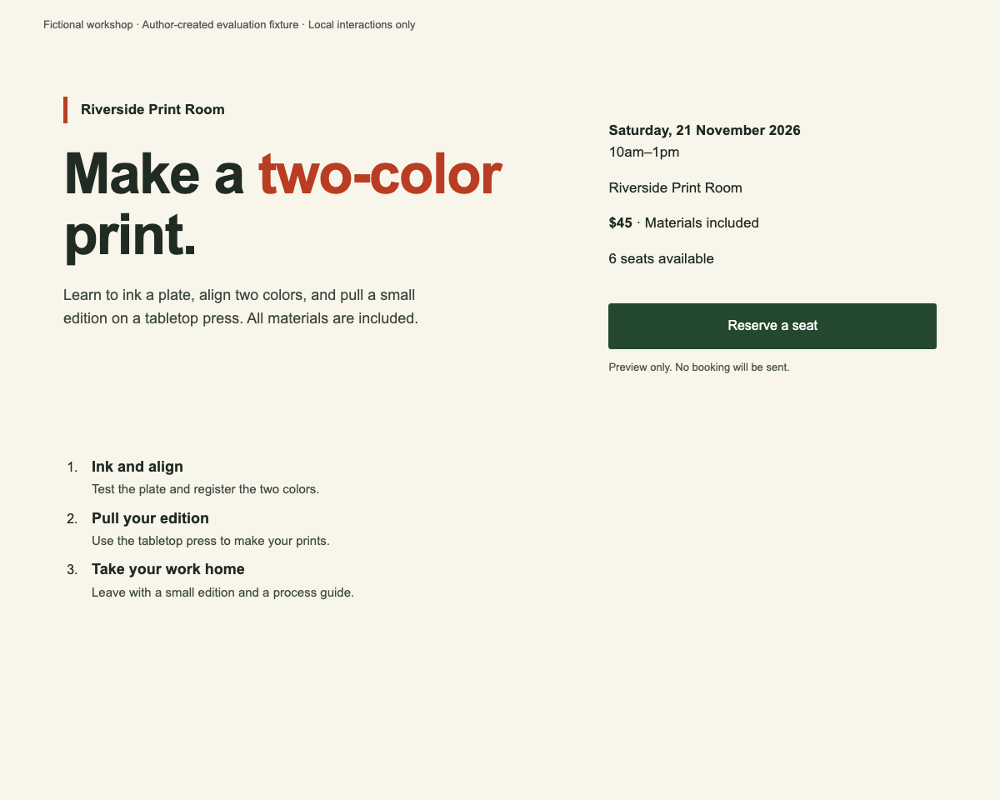
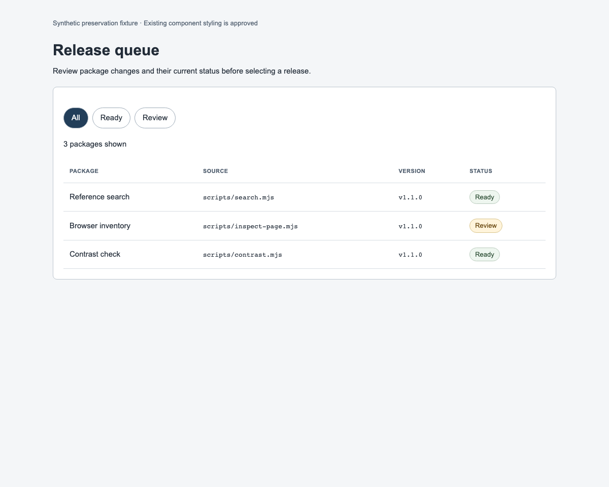

# Author-run rehearsal and negative control

These are synthetic fixtures created for this release. They are not a client's product, recorded model outputs, or evidence of superiority over another skill. The same author defined the expected repairs and reviewed them, so this is a rehearsal and tool test, not an independent or blinded evaluation.

## Workshop correction

[workshop.html](fixtures/workshop.html) uses one content/interaction model with two CSS presentations, selected by `?mode=before` and `?mode=after` when opened in a browser. The fixture is labeled fictional and its reservation control explicitly operates locally.

The rehearsal applies a contextual repair: remove repeated framing labels and redundant copy, consolidate unnecessary boundaries, give the event facts and reservation action a clearer relationship, and tie the display treatment to a print workshop. It preserves the date, time, price, included materials, availability, ordered process, and reserve/undo behavior. The useful sequence remains numbered. No external booking service is implied.

| Before — synthetic fixture | After — authored repair |
| --- | --- |
|  |  |

Captures use the same 1200×960 viewport, content, and initial state. Narrow captures and interaction tests use 390×960 as well. These captures establish the actual fixture appearance; judgments about improvement remain author judgments.

## Preservation counterexample

[working-tool.html](fixtures/working-tool.html) is an approved dense release-queue interface. Status pills communicate real row state; filter buttons act on those states; monospace paths identify actual displayed package sources; short uppercase table headings and rules support comparison. The correct contextual review preserves those features unless a specific problem is demonstrated. A decorative-pattern count alone would be a poor reason to remove them.



The browser inspector intentionally observes these patterns without issuing a verdict. The tests also operate filters and confirm that counts, identifiers, and selected states remain meaningful.

## Automated evidence

The optional [browser tests](../tests/inspector.browser.test.mjs) use a real Chromium page to check read-only inspection, coverage/sample bounds, resolvable selectors, hidden/offscreen handling, the preservation fixture's filters, and the workshop's local reserve/undo behavior at both widths. They do not judge beauty.

A sixth check operates the packaged [comparison lab](../skills/form-explore/assets/comparison-lab.html). It verifies that type and palette can change independently without changing specimen content, proposal export retains the selections, the example semantic color pairs meet normal-text AA contrast ratios, and the sample action remains local. Those checks concern the included example, not arbitrary palettes or a complete accessibility audit.

To regenerate the five rehearsal captures and their bounded observations:

```sh
node scripts/capture-rehearsal.mjs
```

The [captured JSON evidence](../docs/assets/rehearsal-evidence.json) comes from the actual fixtures. [Before](../docs/assets/rehearsal-before-mobile.png) and [after](../docs/assets/rehearsal-after-mobile.png) narrow-view captures are also available.

Run them with an existing Playwright installation:

```sh
node --test tests/inspector.browser.test.mjs
```

If Playwright is outside the checkout, set `FORM_PLAYWRIGHT_MODULE` to its module path. The skills themselves do not require Playwright. `node --test tests/design-skill.test.mjs` remains the dependency-free core test command.

For meaningful model-quality comparisons, use the [scenario inputs](scenarios.json) and the controls in the [research report](../docs/research/2026-11-03-design-quality.md). No matched Impeccable/Emil comparison was run in this release.
